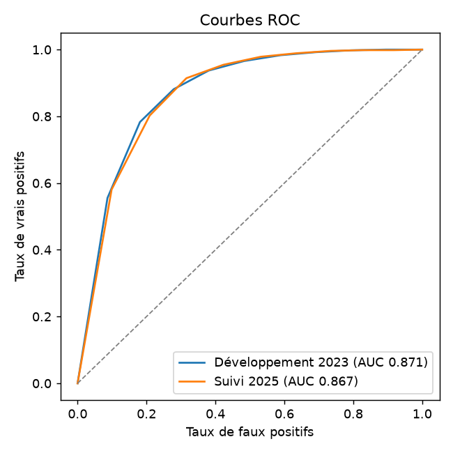
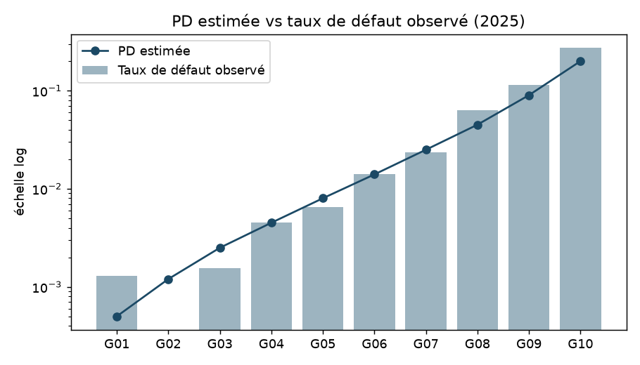

# irb-validation-challenger

Boîte à outils Python de **validation indépendante de modèles de risque de crédit IRB** :
contrôles de qualité des données d'entrée des modèles PD / LGD / CCF, indicateurs et tests
statistiques challengers de performance, et calculateur de RWA conforme à CRR3.

> Projet personnel réalisé sur données **entièrement simulées**. Il illustre une démarche de
> validation (second regard indépendant de la modélisation) ; il ne prétend pas reproduire les
> normes internes d'un établissement.

## Pourquoi ce projet

La fonction de validation doit juger la performance des modèles avec des outils indépendants de
ceux de la modélisation, lors des revues initiales et du suivi annuel (article 185 du CRR ;
supervisory handbook de l'EBA sur la validation des systèmes de notation IRB). Ce dépôt regroupe
trois briques qui répondent à ce besoin :

1. **Qualité des données** — 14 règles réparties par dimension (complétude, validité, cohérence,
   unicité, exactitude) avec statut vert/orange/rouge, plus des analyses challengers : comparaison
   de méthodes de détection des valeurs extrêmes, test du mécanisme des valeurs manquantes, scan
   de fuite de données, PSI.
2. **Performance des modèles** — AUC/Gini avec intervalles DeLong et bootstrap, test de
   dégradation de l'AUC, tests de calibration binomial, de Jeffreys, binomial ajusté de la
   corrélation (Vasicek), Hosmer-Lemeshow, feux tricolores, backtesting LGD.
3. **Calculateur RWA** — formule ASRF (CRR art. 153-154) par classe d'exposition, ajustement PME
   et maturité, planchers de PD et LGD CRR3, plancher de sortie 2025-2030, comparaison CRR2/CRR3
   et sensibilités.

Le portefeuille simulé contient des **anomalies injectées volontairement** (doublons, âge 999,
revenus saisis en centimes, défauts sans date, variable de fuite, sous-calibration des grades
risqués…). La vérité étant connue, on peut mesurer ce que chaque contrôle détecte réellement.

## Résultats de la démonstration

Le rapport complet est dans [`reports/rapport_validation.md`](reports/rapport_validation.md).
Points saillants :

- Les règles déterministes retrouvent **100 %** des anomalies injectées qu'elles ciblent.
- Les revenus manquants ne le sont pas au hasard : taux de défaut de 22 % quand le revenu manque,
  contre 4 % sinon. Les supprimer ou les imputer par la médiane biaiserait le modèle.
- Sur le revenu brut, la règle IQR signale **423** valeurs pour **74** erreurs réelles (revenus
  saisis en centimes) ; appliquée au log du revenu, elle en signale exactement 74.
- Les tests binomial et de Jeffreys rejettent les grades G08-G10, sous-estimés par construction ;
  le test ajusté de la corrélation ne rejette rien : aucun test seul ne sépare effet de cycle et
  défaut de calibration.
- Passer de CRR2 à CRR3 réduit les RWA du portefeuille simulé d'environ 6 % (suppression du
  facteur 1,06), malgré des planchers de PD et LGD plus élevés.

| ROC | Calibration |
|---|---|
|  |  |

## Installation et utilisation

```bash
git clone https://github.com/<votre-compte>/irb-validation-challenger.git
cd irb-validation-challenger
python -m venv .venv && source .venv/bin/activate   # Python ≥ 3.12
pip install -e ".[dev]"

irbval demo                                  # simule le portefeuille et écrit reports/
irbval rw --pd 0.01 --lgd 0.45 --classe corporate --maturite 2.5
pytest                                       # 16 tests, dont valeurs de référence Bâle
```

En Python :

```python
from irbval.rwa.irb import risk_weight, Regime
risk_weight(0.01, 0.45, "retail_mortgage", regime=Regime.crr3())   # array([0.5640])
```

## Structure

```
src/irbval/
├── data.py                    # portefeuille simulé + anomalies injectées
├── quality/checks.py          # règles de qualité, valeurs extrêmes, manquants, fuite
├── performance/
│   ├── discrimination.py      # AUC, Gini, DeLong, bootstrap, test de dégradation
│   ├── calibration.py         # binomial, Jeffreys, Vasicek, Hosmer-Lemeshow, LGD
│   └── stability.py           # PSI, HHI, matrices de migration
├── rwa/irb.py                 # calculateur RWA IRB (CRR2 / CRR3), plancher de sortie
├── report.py                  # pipeline et rapport Markdown
└── cli.py                     # commandes `irbval demo` et `irbval rw`
docs/
├── methodologie.md            # avantages / limites de chaque méthode, cadre d'application
└── migration-python.md        # migrer un outil quantitatif vers Python 3.12+ / pandas 3
```

## Vérification

- Valeurs de référence du Comité de Bâle retrouvées : PD 1 %, LGD 45 %, M 2,5 ans →
  RW 92,32 % (entreprises) et 56,40 % (crédit habitat).
- Tests unitaires et lint (`ruff`) exécutés en intégration continue sous Python 3.12 et 3.13.

## Limites et pistes

- Les pondérations standard utilisées pour le plancher de sortie sont illustratives.
- Prochaines étapes : tests de calibration multi-périodes (PD long terme), bornes de
  Pluto & Tasche pour les LDP, backtesting CCF, export Excel du rapport.

## Auteur

Amine Blaiech — élève ingénieur à l'ENSAI (filière Économie & Finance).
